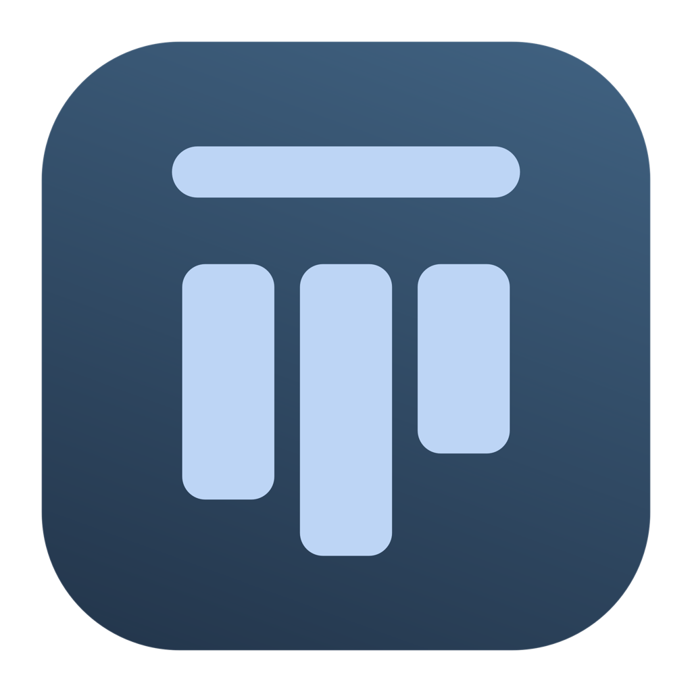
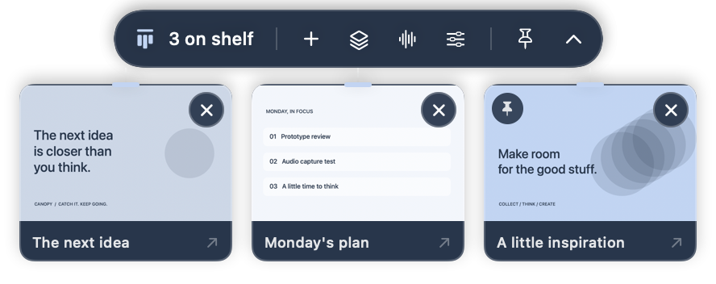
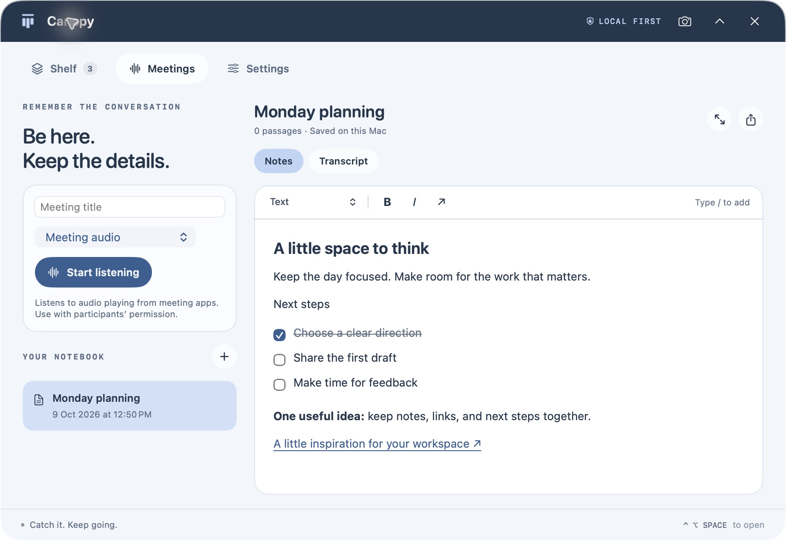

<p align="center">
  
</p>

# Canopy

**A quiet screenshot shelf and meeting notebook for macOS.**

Catch a screenshot, keep it within reach, and get back to work. Canopy lives in the menu bar, revealing a small shelf at the top of your screen when you need it. A separate, movable workspace brings your captures, meeting transcripts, and notes together.

[](LICENSE)


<p align="center"></p>

*Demo images use synthetic content. The shelf image shows an earlier compact toolbar; the current version has a labelled Capture button.*

## What it does

- **Keeps screenshots close.** Capture a region, reveal recent images, drag a copy into another app, or discard one with ×. Click an image to open Apple's Preview for editing. Text recognition runs locally with Vision.
- **Stays out of the way.** Hover over the menu bar to reveal the shelf. Pin it when needed. Move the main workspace anywhere and click outside to hide it.
- **Transcribes meeting audio locally.** Listen to sound playing on your Mac, including meeting apps, with an optional microphone source. Apple's on-device speech engine produces the transcript; Canopy does not save an audio recording file.
- **Keeps notes simple.** Write in one document with headings, links, inline checkboxes, lists, bold, italic, undo, and a `/` block menu. Export notes and transcripts as Markdown.
- **Works without an account.** No subscription, analytics, developer-operated cloud library, or active AI service. The Tiptap/ProseMirror editor ships inside the app and loads offline.

<p align="center"></p>

## Project status

Canopy is an actively developed personal productivity app, now released as open source. The source includes the build-24 Store changes. App Store approval is pending; this repository does not contain a notarized public installer or claim that the candidate is approved.

The latest recorded validation passed **158 direct-build Swift tests and 156 Store-configuration Swift tests** on an Apple silicon Mac running macOS 27.0.1. Local system-audio transcription was previously exercised with generated speech. Build-24 region selection and Escape cancellation were checked; a completed physical region-capture check is still pending. Intel and macOS 26 physical validation remain outstanding. See [validation](docs/VALIDATION.md) for the scope of these results.

## Build and run

Use a Mac with a **Swift 6+ toolchain and a macOS 26+ SDK**. Full Xcode is recommended. The direct edition targets macOS 14+; the sandboxed Store target requires macOS 26+. Older systems use compatibility paths for audio and speech, with different permission requirements.

```sh
git clone https://github.com/headria/Canopy.git
cd Canopy
./scripts/build-app.sh
open build/Canopy.app
```

The build script selects a single available Apple Development or Developer ID Application certificate. If you have several, choose yours explicitly:

```sh
CANOPY_SIGN_IDENTITY="Apple Development: Your Name (YOURTEAMID)" ./scripts/build-app.sh
```

For a disposable local preview without a signing certificate:

```sh
CANOPY_SIGN_IDENTITY=- ./scripts/build-app.sh
open build/Canopy.app --args --demo
```

Ad hoc signing is for development and does not preserve the app's permission identity across rebuilds. Demo mode uses synthetic notes and disposable storage, with meeting recording disabled. Build an `.app` bundle using the script rather than running the bare executable when testing macOS permissions. Building does not install the app in `/Applications`.

Open `Package.swift` in Xcode for Swift package development. For the sandboxed target, open `Canopy.xcodeproj` and follow [Store configuration](Store/README.md). Use your own bundle identifiers and signing team for distributed forks.

## Daily use

| Action | Control |
| --- | --- |
| Show or hide the shelf | Control–Option–Space or the menu-bar icon |
| Reveal the small shelf | Hover over the menu bar |
| Capture a region | Control–Option–S or Capture |
| Cancel a capture | Escape |
| Keep the shelf open | Pin button |
| Edit an image | Click it to open Preview |
| Share a copy | Drag the image into another app |
| Remove a capture from Canopy | × on the image |
| Move the workspace | Drag beside the Canopy title |
| Add a note block | Type `/` in the notes editor |

Captures remain in Canopy until discarded. Dragging or exporting creates a separate copy. Preview may ask to save an edited copy; simplifying that flow is deferred.

### Screenshot behavior by edition

The **sandboxed Store edition** uses public ScreenCaptureKit for Capture / Control–Option–S. It stores the selected region directly in its library without creating a Desktop image or invoking macOS's corner thumbnail. It never changes macOS screenshot preferences. To detect ordinary Shift–Command–3/4 screenshots, choose their save folder in Canopy; the watcher copies new images and leaves originals in place. macOS controls its own thumbnail behavior.

The **direct edition** can optionally route ordinary macOS screenshots into Canopy's private inbox and suppress the system thumbnail while running. It journals previous settings and restores them on normal quit or when the feature is disabled. This system-preference adapter is excluded from the Store binary. See [architecture](docs/ARCHITECTURE.md) for the separation.

### Meeting audio and permissions

Choose **Meeting audio**, then **Start listening**. On macOS 14.2+, a Core Audio tap captures sound from other apps without the microphone. On supported macOS 26+ Macs, SpeechAnalyzer/SpeechTranscriber uses local language assets; their first download may take time. Microphone permission is needed only if you choose a microphone source. Legacy speech paths may need Speech Recognition access and macOS Dictation enabled.

System-audio access and screenshot screen-capture access are separate permissions. The app offers recovery guidance after a refusal. Permission requests never start recording automatically. A visible recording indicator stays in the menu bar while listening.

System capture includes other audio playing on the Mac, rather than isolating one meeting app or identifying individual speakers. Pause unrelated playback and use transcription with participants' permission. Unsupported languages or unavailable local models produce an error instead of falling back to cloud transcription.

## Privacy and storage

Screenshots, OCR text, notes, and transcripts stay on your Mac. The direct edition uses `~/Library/Application Support/Canopy/`; the Store edition uses its sandbox container. Settings includes **Reveal library**. Audio is processed in memory, with no recording file saved. Apple manages speech-model downloads; following a note link opens the destination in your browser.

Library JSON and image files are local plaintext protected by filesystem permissions, not app-level encryption. Preview working copies and drag-transfer files are also local. Exported files and system backups can survive deletion from the app. A legacy-library migration can retain a local backup.

AI/Ask controls are deferred. Earlier API adapters and migration fields remain in source for compatibility, but the current interface has no AI requests or API-key configuration. No credentials are bundled in this repository. See the [privacy policy](Resources/PrivacyPolicy.txt).

## Development

```sh
# Swift tests (no live meeting recording)
./scripts/test.sh

# Store compilation conditions, using a separate scratch directory
./scripts/test.sh --scratch-path build/store-tests -Xswiftc -DCANOPY_APP_STORE

# Source configuration and bundled editor integrity
python3 scripts/check-store-readiness.py
```

Editor assets are checked in, so building the app does not need Node. To change the editor, use Node 20+:

```sh
cd EditorWeb
npm ci --ignore-scripts
npm test
npm run build
```

Commit the updated source, bundled assets, third-party notices, and hash manifest together. The build rejects a stale editor bundle.

The core is a Foundation-only Swift module. SwiftUI views and an AppKit panel sit above injected persistence, capture, transcription, OCR, and editing adapters. See [architecture](docs/ARCHITECTURE.md), [contributing](CONTRIBUTING.md), and [security reporting](SECURITY.md).

## License and credits

Canopy's original source and artwork are available under the [MIT license](LICENSE), including commercial use. Bundled dependencies retain their own notices in [ThirdPartyNotices.txt](Resources/NoteEditor/ThirdPartyNotices.txt). Apple frameworks and SDKs are provided by Apple under their terms. The license does not grant trademark rights or imply endorsement of forks.

The high-level top-of-screen screenshot interaction was inspired by [Tendedero](https://github.com/alejandrobujan/tendedero). Its code, artwork, icon, and brand were not copied. Canopy was implemented independently, with AI-assisted development and Claude Code review assistance.
