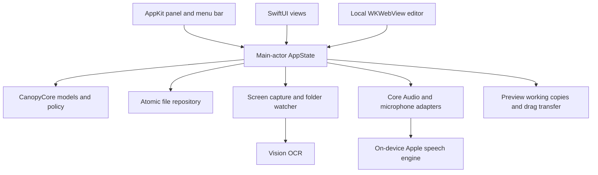

# Architecture

Canopy combines a native SwiftUI workspace, an AppKit menu-bar shell, and a locally bundled Tiptap/ProseMirror document editor. Swift code has no external Swift package dependencies; JavaScript editor dependencies are pinned in `EditorWeb/package-lock.json`.

## Composition and state

`CanopyMain.swift` is the composition root. `AppState` orchestrates feature operations through injected services and owns cancellation. SwiftUI views invoke explicit actions rather than opening capture devices or writing files themselves. `MeetingNotebookState.swift` manages note editing and flush boundaries.

`CanopyCore` imports Foundation only. It contains Codable models, atomic file persistence, note-document representations, screenshot discovery and settings policies, hover timing, shelf presentation, and workspace placement. Pure policy can be tested independently of windows and devices.

The library validates referenced filenames and schema versions before loading. Unknown or corrupt libraries are preserved and new work is routed to a recovery directory. Rich-note upgrades preserve old plain text until editing and create a local migration backup. Demo mode always uses a separate disposable repository.

## Shelf and workspace

`ShelfPresentation` models hidden, arrival, compact shelf, and workspace modes. `ShelfPanelController` maps that policy onto a borderless AppKit panel. Temporary shelf modes anchor below the menu bar; the main workspace has independent saved placement. Hover and capture arrival reveal the shelf without stealing focus. Outside clicks hide the workspace, while active menus, dialogs, editor popovers, and drags retain their interaction lifetimes.

The capture lifecycle hides Canopy before selection. Arrival is published after a durable image and library update, before OCR. Cancellation adds nothing; failure returns to an actionable workspace. Thumbnail decoding is cached separately from full-resolution files.

## Screenshot capture and distribution

The Store target uses `StoreRegionScreenshot`: a native region selector followed by public ScreenCaptureKit capture. The capture filter excludes Canopy's own windows. `RegionCaptureGeometry` converts AppKit's coordinate origin to the screen capture origin.

Folder detection uses stable-file checks, incoming identities, and successful-import acknowledgments to avoid partial or duplicate imports. Store folder access is scoped to a user-selected bookmark. External originals are copied, not consumed. Pending images in an older app-owned inbox are recovered separately.

`AppDistribution` separates direct and Store behavior. The direct edition's optional system screenshot routing uses a recoverable `ScreenshotSettingsLease`. The Store build excludes `NativeSystemScreenshotManager` and `MacScreenshotPreferences` with compilation conditions, disables stale routing flags, and has no temporary exception entitlement. It never modifies the system screenshot destination or thumbnail preferences.

`CaptureInteractionService` provides native Preview opening, image/file drag representations, and temporary transfers. Preview works on local edit copies; saved changes update thumbnails and OCR. Discard removes the shelf file and working copy. Temporary drag files have bounded retention. Preview's save-copy interaction is a known deferred usability issue.

## Audio and transcription

Meeting audio defaults to output from other apps. On macOS 14.2+, `SystemAudioTap` owns a private Core Audio process tap and aggregate device; it has no physical microphone input. Optional microphone capture uses AVAudioEngine with copied buffers. Earlier systems retain a ScreenCaptureKit compatibility path.

Supported macOS 26+ Macs use `AnalyzerSpeechChannel` with local SpeechAnalyzer/SpeechTranscriber assets. Other environments retain an on-device legacy recognizer. Audio remains in memory. Run identities, serial processing, cancellation and finalization keep late callbacks from mutating a subsequent meeting. An activity meter distinguishes silent samples from missing callbacks without inferring a permission refusal. Stop finalizes text and saves the library.

System audio permission has no public read-only Core Audio authorization preflight. It is checked on an explicit Start listening action; screen capture preflight is not substituted for it. Permission status refreshes do not start audio. Microphone and legacy Speech Recognition use their respective authorization APIs. Recovery text remains separate from the recording action.

## Notes editor

`RichNoteEditor` bridges a local WKWebView to a pinned Tiptap/ProseMirror bundle. No runtime editor code is downloaded. The bridge validates document messages and link schemes, tracks real user revisions, and flushes before navigation/export/shutdown. It retains plain-text and Markdown forms for search and export. `scripts/check-editor-bundle.py` verifies source, lockfile, generated assets and license-notice hashes together.

## Deferred integrations

Earlier assistant and Jev adapters remain behind injectable service protocols for compatibility and future work. Current navigation and settings have no AI entry points. Daily settings do not read or overwrite retained Keychain credentials. Their presence in source is not a claim that AI features ship in the current interface.
